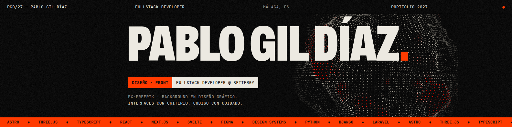
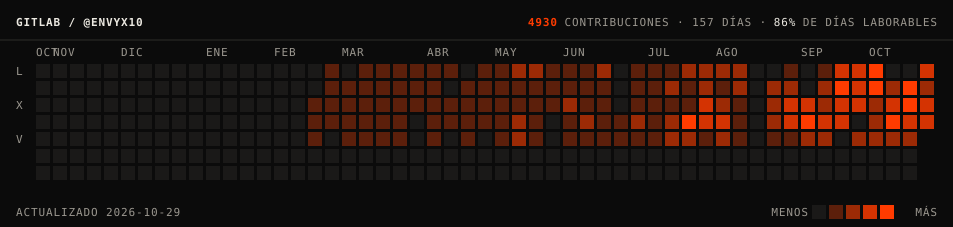
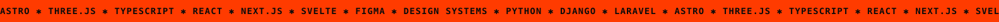

<a href="https://envy-portfolio.vercel.app/">
  
</a>

### `01` — SOBRE MÍ

Fullstack developer en **[Bettergy](https://www.bettergy.es)**, construyendo plataformas de gestión energética e IoT industrial. Vengo del diseño gráfico y pasé por **Freepik** como Frontend Engineer: por eso el frontend es donde más disfruto, aunque bajo al backend (Django / DRF) para que las vistas tengan datos de verdad detrás.

<table>
  <tr><td><code>DISEÑO × FRONT</code></td><td>Interfaces reactivas y accesibles. Cada píxel y cada estado de la UI importa.</td></tr>
  <tr><td><code>BACKEND</code></td><td>APIs, modelos de datos y lógica de negocio con código mantenible.</td></tr>
  <tr><td><code>IA</code></td><td>Integro LLMs y automatizo flujos para aportar valor real al producto.</td></tr>
  <tr><td><code>HARDWARE</code></td><td>6 años como técnico informático y modding de PCs. Conozco la máquina desde abajo.</td></tr>
</table>

> **¿Poca actividad en la gráfica de GitHub?** Mi día a día de trabajo vive en **[GitLab](https://gitlab.com/envyx10)**. Este es el calendario real, actualizado cada día:

<a href="https://gitlab.com/envyx10"></a>

---

### `02` — STACK

      <br/>
     

---

### `03` — INDEX

| Nº | Proyecto | Tipo | Año | Stack |
|:--|:--|:--|:--|:--|
| `01` | **MIOT** — monitorización IoT industrial: sensores, alarmas y telemetría en tiempo real | Trabajo | 2026 | Next.js · TanStack Query · Django |
| `02` | **[DesignHub](https://designhub-psi.vercel.app/es/)** — paletas y recursos de branding para mi flujo de trabajo | Herramienta | 2026 | Astro · Svelte · TS |
| `03` | **[Pixela](https://github.com/envyx10/Pixela)** — reseñas y valoraciones de series y películas (TFG) | Personal | 2025 | Next.js · Laravel · MariaDB |
| `04` | **[Pixela Figma](https://www.figma.com/design/CPQe3LpPHQXKW1AWTYJhOG/PROYECTO-PIXELA.IO?node-id=0-1)** — prototipos y sistema de diseño | Diseño | 2025 | Figma · UI/UX |
| `05` | **[Portfolio](https://github.com/envyx10/mi-portfolio)** — suizo × brutalista, esfera WebGL con shaders GLSL | Personal | 2026 | Astro · Three.js |

<p>
  <a href="https://envy-portfolio.vercel.app/"></a>
</p>

---

### `04` — TRAYECTORIA

```txt
2026 ── HOY    BETTERGY              FULLSTACK DEVELOPER
2025           FREEPIK               FRONTEND ENGINEER
2017 ── 2023   VS GAMERS / ATLAS     TÉCNICO INFORMÁTICO
2014 ── 2016   OZONE GAMING          DISEÑADOR GRÁFICO
```

---

### `05` — CONTACTO

<p>
  <a href="https://www.linkedin.com/in/envyx10/"></a>
  <a href="https://gitlab.com/envyx10"></a>
  <a href="mailto:pabloinfodesign95@gmail.com"></a>
</p>

<sub>Nu-metal de fondo mientras codeo. Dark mode hasta en el microondas.</sub>


